<picture><source media="(prefers-color-scheme: dark)" srcset="assets/header-dark.svg"></picture>

 

<picture><source media="(prefers-color-scheme: dark)" srcset="assets/about-dark.svg"></picture>

 

<picture><source media="(prefers-color-scheme: dark)" srcset="assets/experience-dark.svg"></picture>

 

<a href="https://link.springer.com/chapter/10.1007/978-3-032-08240-4_9"><picture><source media="(prefers-color-scheme: dark)" srcset="assets/research-dark.svg"></picture></a>

 

<picture><source media="(prefers-color-scheme: dark)" srcset="assets/stack-dark.svg"></picture>

 

<a href="https://malaydoshi.tech"><picture><source media="(prefers-color-scheme: dark)" srcset="assets/btn-site-dark.svg"></picture></a>
<a href="https://linkedin.com/in/malaydoshi"><picture><source media="(prefers-color-scheme: dark)" srcset="assets/btn-linkedin-dark.svg"></picture></a>
<a href="https://x.com/malaydoshi711"><picture><source media="(prefers-color-scheme: dark)" srcset="assets/btn-x-dark.svg"></picture></a>
<a href="mailto:malaydoshi711@gmail.com"><picture><source media="(prefers-color-scheme: dark)" srcset="assets/btn-mail-dark.svg"></picture></a>

<picture><source media="(prefers-color-scheme: dark)" srcset="assets/footer-dark.svg"></picture>
